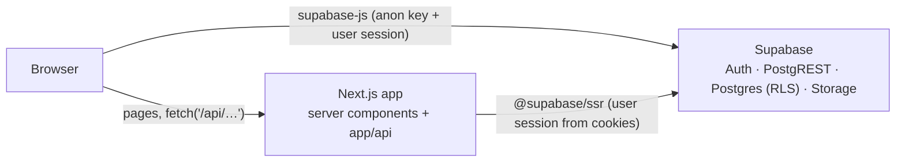

# Architecture

How the system is built today. For the assessment, risks and target design, see [ARCHITECTURE_REVIEW.md](ARCHITECTURE_REVIEW.md). For the fixes, see [REMEDIATION_GUIDE.md](REMEDIATION_GUIDE.md).

## Overview

LKHC is a single **Next.js 16 (App Router) + Supabase** application. There's no separate backend service: the "backend" is the route handlers in `app/api/` plus Supabase (Postgres, Auth, Storage), and both deploy with the frontend.

| Layer | Technology |
|---|---|
| UI | React 19, Tailwind CSS v4, shadcn/ui (Radix), lucide-react, Sonner toasts |
| App | Next.js 16 App Router, TypeScript (strict) |
| Data/Auth | Supabase via `@supabase/ssr` and `@supabase/supabase-js` |
| i18n | i18next + react-i18next; `messages/en.json`, `messages/am.json` |
| Fonts | Varela Round via `next/font/google` (`lib/fonts.ts`) |

## Directory map

| Path | Contents |
|---|---|
| `app/page.tsx` | Redirects to `/dashboard` or `/auth/login` (server) |
| `app/auth/*` | Login, sign-up, sign-up success, error pages (client) |
| `app/dashboard/layout.tsx` | Server gate: requires a user, loads the profile, renders the sidebar |
| `app/dashboard/**/page.tsx` | Feature pages; all client components except the dashboard home |
| `app/dashboard/ministry/*` | Ministry hub and 14 ministry pages (Women and Spiritual Service use real APIs; 12 use mock data) |
| `app/api/**/route.ts` | 46 route files: auth check, then a Supabase query, then JSON |
| `components/` | `sidebar.tsx`, `ministry/*`, `ui/*` primitives, i18n provider, language selector |
| `lib/supabase/server.ts` | Server client (cookie session); used by route handlers and server components |
| `lib/supabase/client.ts` | Browser client; used by client pages that query directly |
| `lib/supabase/proxy.ts` | Session-refresh helper. **Not wired up yet** (needs a root `proxy.ts`; Remediation 1.7) |
| `lib/audit.ts` | Browser-side audit logging (to be replaced by DB triggers; Remediation 1.5) |
| `scripts/*.sql` | Hand-run SQL migrations (see [SETUP.md §3](SETUP.md#3-build-the-database-new-project) for the working order) |
| `scripts/setup-demo-accounts.js` | Dev/demo account seeding ([DEMO_SETUP.md](DEMO_SETUP.md)) |
| `docs/remediation/sql/` | Tested security and integrity fixes |

## How a request flows

There are three data paths:

1. **Server components** (`/`, `/dashboard`, dashboard layout): `createClient()` from `lib/supabase/server.ts` reads the session from cookies and queries Supabase as the user.
2. **Client page → API route** (18 pages): `fetch('/api/…')` → `route.ts` calls `supabase.auth.getUser()` (401 if signed out) → queries Supabase as the user → `NextResponse.json`.
3. **Client page → Supabase directly** (members, financial, calendar, events, attendance, ministries, reports, register, settings): the browser client queries PostgREST with the anon key and the user's token.

All three run as the signed-in user, so **row-level security (RLS) in Postgres is the only control they share**. The service-role key is never used by the app.

## Authentication and roles

- Supabase email and password auth. On sign-up, the `on_auth_user_created` trigger creates a `profiles` row.
- Session in cookies via `@supabase/ssr`.
- Roles live in `profiles.role`: `admin`, `elder`, `ministry_leader`, `finance` or `member`. The legacy `profiles.is_admin` flag is kept in sync once remediation 01 is applied. The intended matrix and how it's enforced are in [ROLES_AND_ACCESS.md](ROLES_AND_ACCESS.md).

## Data model (summary)

66 tables in `public`. Main groups:

| Group | Tables |
|---|---|
| People and access | `profiles` (doubles as member record; see review F-20), `user_preferences`, `audit_log` |
| Ministries | `ministries`, `ministry_members`, plus per-ministry tables from `015` (choir, worship, women, youth, children, mission, prayer, deacons, charity, workers' aid, teaching, administration) |
| Events and attendance | `events`, `attendance_records`, plus module-specific schedules and attendance tables |
| Finance | `financial_transactions` (`transaction_type`, `category`, `amount`, `member_id`, `recorded_by_id`) |
| Communication and content | `announcements`, `message_templates`, `documents`, `translations` |

## Storage

Private bucket **`documents`**. `POST /api/documents` uploads to `<user-id>/<timestamp>-<file-name>` and stores metadata in `documents` (`file_path`, `file_size_bytes`, `content_type`, `uploaded_by_id`, `access_level`, default `Staff Only`). `GET /api/documents?id=` returns a 60-second signed URL. Bucket policies come from remediation `02_rls_rewrite.sql`.

## Audit logging

Today `lib/audit.ts` posts to `/api/audit-log` from the browser after some mutations. After remediation `03_audit_log.sql`, database triggers write `audit_log` for every change to sensitive tables, and the browser path is removed.

## Internationalisation

`components/i18n-provider.tsx` initialises `lib/i18n/i18n.ts` (English and Amharic, browser language detection, stored in `localStorage`). The sidebar's language selector switches language. Only the login page and sidebar use `t()` so far.
