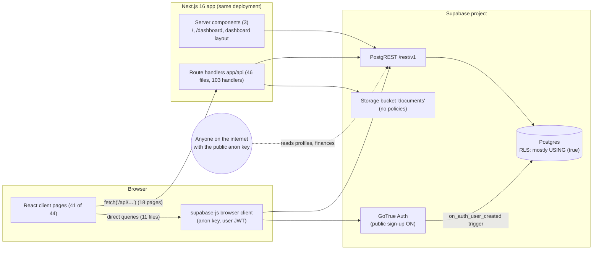
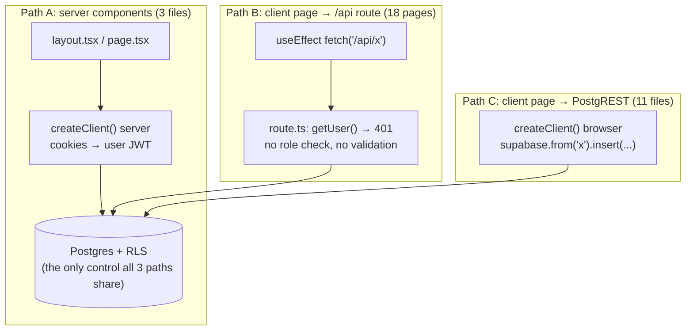
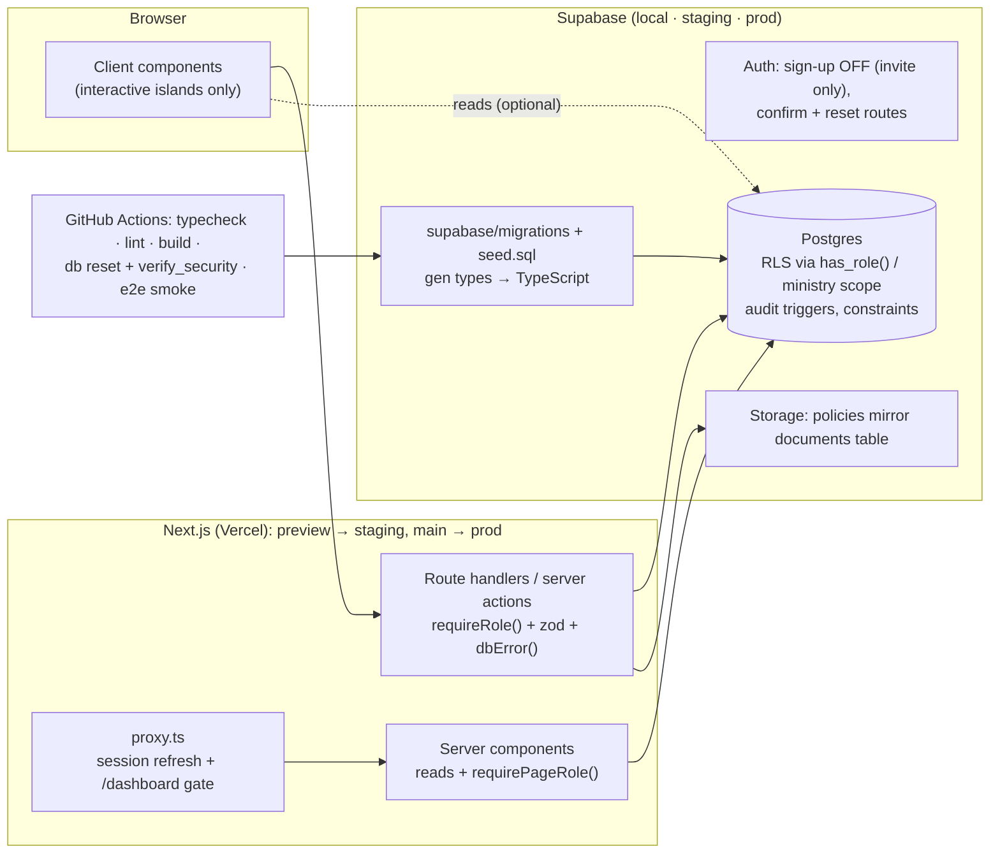

# Architecture Review: LKHC Church Management Platform

| | |
|---|---|
| **Date** | 2026-10-17 |
| **Scope** | Whole repository (commit `242e37b` plus the working tree), the PRD and docs, the running app, and the live Supabase project (anonymous REST probe only) |
| **Method** | Static review of all 46 API routes, 44 pages, 18 SQL scripts and 23 docs. Type-check, lint, `npm audit` and production build. Every migration replayed on fresh Postgres. The app was driven in Chrome as an admin and as a member against a throwaway Supabase stack, and every exploit below was reproduced there. |
| **Fix plan** | [REMEDIATION_GUIDE.md](REMEDIATION_GUIDE.md). Every finding ID (`F-nn`) below maps to a step in it. |

---

## 1. Executive summary

LKHC is a **Next.js 16 + Supabase** monolith: one repo, one deployment, with Supabase providing Postgres, Auth and Storage. The stack is a good fit for a church-sized organisation. Operations are light, it's cheap to run, the UI is consistent, and the newest modules (Women, Spiritual Service) show the right patterns.

The system is **not production-ready**, and the reasons are architectural rather than cosmetic:

1. **The security boundary is in the wrong place.** The design sends the anon key to every browser and lets pages query the database directly. That is only safe when Row Level Security (RLS) is the authorisation layer. Here RLS was loosened to `USING (true)` to get past an RLS recursion error, and authorisation moved into the sidebar, where it only hides links. **Live result (2026-10-17):** without logging in, anyone can read member profiles and the financial ledger, and anyone can sign up and make themselves admin.
2. **The schema has no source of truth.** Migrations are pasted into the SQL editor by hand. The repo cannot rebuild the database: 5 scripts fail on a fresh database, including a syntax error in the 34-table PRD migration. Production lacks 38 tables that the code depends on, and the code calls 9 tables that exist nowhere.
3. **"Member" and "user" are the same thing.** `profiles.id` is the login id, but most church members will never log in (children, the elderly, visitors). This one modelling choice is why the foreign key was dropped (`010`) and why member registration cannot work.
4. **There are two data paths and no shared contract.** 11 files query Supabase from the browser and 18 pages go through `/api`. API routes come in 4 copy-paste generations with no shared auth, validation or error handling. There are no generated database types, so code using wrong column names compiled fine and failed at runtime.
5. **There is no operational backbone.** No tests, CI, environments (dev/staging/prod), monitoring or backups. The production project was paused or deleted on 2026-10-16 and nobody noticed until this review.

**Findings by severity:** 7 Critical, 19 High, 12 Medium, 3 Low (41 total, §12).
**Estimated effort to production:** about 57–78 developer-days for one experienced developer (≈ 3–4 months; Phase 0 takes 1–2 days). Breakdown in the guide.

---

## 2. System context (as built)

| Concern | Choice | Assessment |
|---|---|---|
| Runtime | Next.js 16.0.10 (App Router, Turbopack), React 19, TypeScript strict | Modern and good. 16.0.10 carries a critical advisory (F-12) |
| Data/Auth | Supabase (Postgres, GoTrue, PostgREST, Storage) via `@supabase/ssr` | Good fit, but it forces RLS-first security, which wasn't done (F-01..F-07) |
| UI | Tailwind v4, shadcn/Radix (13 primitives), Sonner, lucide | Consistent and clean. 34 unused dependencies (F-40) |
| i18n | i18next + react-i18next, `messages/en.json` and `am.json` | The infrastructure is sound, but only about 1% of strings go through it (F-33) |
| Hosting | Vercel implied (`@vercel/analytics`, docs) but not configured | No IaC, no environments (F-37) |
| PRD intent | Express/Django, AWS S3, Twilio (PRD §5) | The stack changed without a recorded decision. Add an ADR. |

---

## 3. Codebase shape

| Area | Files | Lines | Notes |
|---|---:|---:|---|
| `app/dashboard` (pages) | 40 | 13,883 | 41 of 44 pages are `'use client'`. Largest: register (1,338), women (647), spiritual-service (613) |
| `app/api` (route handlers) | 46 | 2,758 | 103 handlers in 4 copy-paste "generations" (§7) |
| `components` | 21 | 1,870 | Sidebar, ministry dashboard, member picker, 13 UI primitives |
| `lib` | 7 | 209 | Supabase clients, audit helper, i18n, fonts |
| `scripts` (SQL + seed) | 18 | 1,985 | 66 tables, created by 7 of the files |

Of the 44 pages, 12 render hard-coded `MOCK_*` data, 11 are linked from nowhere, and 8 call APIs whose tables don't exist (F-26). Git history has **2 commits** with very large messages, so changes can't be reviewed or rolled back one at a time (F-40).

---

## 4. Request and data flow

The app has **three ways** to reach data, and each enforces different things:

**Analysis**
- **RLS is the only control that all three paths share, so it has to carry all authorisation.** Path C bypasses every API check by design, and anyone can call PostgREST directly with the anon key, outside the UI. API-level checks alone can never secure this app (F-24).
- **Path B adds latency without adding safety.** The routes check only "is someone logged in", which RLS already knows, and they pass request bodies straight through (mass assignment, F-25).
- **No data layer.** Every client page does fetch-in-`useEffect` with local state: no caching, no deduplication, waterfalls on navigation. The ministry hub makes 14 sequential count requests. Reports pull every transaction into the browser and add them up in JavaScript floats, and PostgREST caps responses at 1,000 rows, so totals silently stop counting rows past that (F-30).
- **No shared types.** Nobody ran `supabase gen types`, so `supabase.from('financial_transactions').select('type')` compiles even though the column is `transaction_type`. **Every runtime schema bug found in this review would have been a compile error with generated types** (F-17, F-18, F-19, F-21).

---

## 5. Identity, session and authorisation

### 5.1 Auth flows
| Flow | Implementation | Gap |
|---|---|---|
| Sign-up | `auth.signUp` with `first_name`/`last_name` metadata. A trigger creates `profiles` | The trigger also copies `is_admin` from metadata, which the client controls (F-02). Public sign-up is **on** in the live project |
| Email confirmation | Supabase default email. No `emailRedirectTo` and no `/auth/confirm` route | Users land on the Site URL with no session and must log in by hand (F-35) |
| Sign-in | `signInWithPassword` in the browser | Fine. Debug logging of email and key prefixes is removed in this change (F-13) |
| Password reset | None | Users who forget their password are locked out (F-35) |
| Sign-out | `auth.signOut()` in the sidebar | Fine |

### 5.2 Session
`@supabase/ssr` keeps the session in cookies. Refreshing tokens needs a request interceptor (`proxy.ts` in Next 16). **None exists.** `lib/supabase/proxy.ts` is dead template code that only guards `/protected`, and `lib/supabase/server.ts` silently discards cookie writes made from server components. Expired tokens therefore aren't saved after refresh, and users get logged out at random (F-11).

### 5.3 Authorisation layers: intended vs actual

| Layer | Intended | Actual (verified) |
|---|---|---|
| Sidebar | Hide links by role | Works for `is_admin` only. The layout never selects `role`, so leaders, finance and elders all see the 3-item member menu (F-08) |
| Page routes | Gate by role | **None.** A member typing `/dashboard/financial` sees every tithe and can delete it (screenshot evidence) |
| API routes | Gate by role | 1 of 103 handlers checks a role (`audit-log` GET, `is_admin` only). `/api/profile` PATCH writes the raw body, so a member can send `{"is_admin":true}` and becomes admin (F-03) |
| RLS | Enforce the role matrix | Mostly `USING (true)`, often without `TO authenticated`, so **anonymous** visitors can read and write (F-01, F-04). Migration 015 gives *any* leader write access to all 34 ministry tables (F-06) |
| Storage | Staff-only documents | No `storage.objects` policies at all. `access_level` is stored but never checked (F-07) |

### 5.4 Role model
There are two sources of truth: `profiles.is_admin` (001) and `profiles.role` (014, free text with no CHECK). Different layers read different ones: the layout and the audit API read `is_admin`, RLS 015 reads `role`, and the docs say both. Neither is protected from the user editing their own row.

**Root cause:** migration 001's policies on `profiles` sub-selected `profiles`, which raises *infinite recursion* (42P17). The "fix" (007/008) removed the checks instead of moving the role lookup into a `SECURITY DEFINER` helper. [01_emergency_lockdown.sql](remediation/sql/01_emergency_lockdown.sql) restores one role column (with a CHECK), the recursion-safe helpers `current_app_role()` and `has_role(...)`, and a trigger that blocks self-promotion.

---

## 6. Data architecture

### 6.1 Inventory
There are 66 tables across 7 scripts: 001 (6), 003 (17), 004 (5), 011 (2), 012 (1), 014 (1), 015 (34).

| Domain | Tables (examples) |
|---|---|
| People and access | `profiles`, `user_preferences`, `audit_log` |
| Ministries (generic) | `ministries`, `ministry_members`, `committees*` |
| Worship and events | `events`, `worship_events`, `spiritual_services`, `choir_schedule`, `women_meetings`, `worship_rehearsals` |
| Attendance | `attendance_records`, `children_attendance`, `spiritual_class_attendance` |
| Money | `financial_transactions`, `charity_distributions`, `workers_aid_disbursements` |
| Pastoral care | `counseling_services`, `deacon_care_visits`, `deacon_support_cases`, `prayer_requests`, `spiritual_follow_ups` |
| Content | `announcements`, `message_templates`, `documents`, `teaching_materials`, `translations` |

### 6.2 Schema lifecycle and drift (F-17)
- **No tooling.** There's no `supabase/` directory, no migration table, and the instruction is "paste into the SQL editor".
- **The repo can't rebuild itself.** On a fresh database, 005, 006 and 009 fail (FK to auth users that don't exist), 007 fails (`policy already exists`), and **015 fails on a syntax error**: a misplaced parenthesis means the 34 PRD tables are never created.
- **Production ≠ repo.** The live anonymous probe on 2026-10-17 found:

| | Count | Detail |
|---|---:|---|
| Tables readable **without login** | 7 | `profiles` (20 rows), `financial_transactions` (8), `attendance_records` (8), `ministries` (10), `ministry_members` (10), `events` (5), `translations` (16) |
| Tables in repo migrations but **absent in production** | 38 | All of 011, 012, 014 and 015: announcements, documents, audit log and every PRD ministry table |
| Tables the code calls that **exist nowhere** | 9 | `attendance`, `counseling_records`, `health_wellness`, `facility_management`, `media_communications`, `music_ministry`, `worship_services`, `community_service`, `education_training` |

  So Communications, Documents, Audit Log, Women and Spiritual Service cannot work in production as deployed. (A PostgREST 404 means the table isn't exposed; confirm with [inspect_schema.sql](remediation/sql/inspect_schema.sql).)

### 6.3 Modelling issues
- **Person ≠ account (F-20).** `profiles` serves as both "church member record" and "login account" (`id = auth.users.id`). Registering a member who has no login needs an id that doesn't exist, which is why `010` dropped the FK and the registration insert fails. **Target:** a `members` table for every person, plus `profiles` for login accounts with an optional `member_id`. Families, ministries, attendance and giving point at `members`.
- **Duplicated concepts (F-22).** Five "event-like" tables (`events`, `worship_events`, `spiritual_services`, `choir_schedule`, `women_meetings`), three team-membership tables, three attendance tables, and `baptisms` alongside `spiritual_candidates.baptism_date`. Each module invents its own shape, so cross-module reports (attendance per person, a ministry calendar) can't be built.
- **Money (F-18).** `transaction_type` holds labels ('Tithe', 'Expense') while the app expects `income`/`expense` plus a category, which is why the Financial page shows every row as an expense with $0 totals. Seed data mixes a type of `Expense` with negative amounts. The currency defaults to USD for an Ethiopian church. Charity and workers-aid payouts live outside the ledger, so the books don't balance by construction.
- **Time.** `013` adds `event_date`/`event_time` (time stored as **text**) next to `start_date`/`end_date`. The calendar writes one pair and the dashboard reads the other. End-before-start is allowed.
- **Integrity (F-14, F-15, F-16).** About 30 tables declare `updated_at` but nothing maintains it. There are no CHECK constraints or enums for status values. About 40 foreign keys have no index. NOT NULL "actor" columns (`recorded_by_id`, `organizer_id`) are left unset by the app, so its inserts fail.

### 6.4 RLS posture: before and after remediation

| Data | Today (live / repo) | After [01](remediation/sql/01_emergency_lockdown.sql) + [02](remediation/sql/02_rls_rewrite.sql) |
|---|---|---|
| Member profiles (PII) | Anyone, including anonymous visitors | Own row. Staff (admin, elder, leader, finance) see the directory |
| Profile role / admin flag | The user edits it themselves | Admin only (trigger, error 42501) |
| Financial ledger | Anyone reads and inserts | admin/elder/finance read; admin/finance write; members see their own giving |
| Pastoral care, aid, prayer | Every signed-in member reads | admin/elder plus the assigned counsellor or deacon |
| Rosters, attendance, children | Every signed-in member reads | Staff only |
| Audit log | Anyone inserts (forgeable); `is_admin` reads | Written only by triggers; admin/elder read |
| Storage `documents` | No policies | Staff read/write. Members only see rows marked `All Members` |
| Unclassified tables | Varies | Deny-all, listed by the script for a deliberate decision |

`verify_security.sql` turns this table into executable checks. It reports **11 failures** against the repo's current policies and **0** after remediation.

---

## 7. API layer (F-25, F-26)

| Generation | Routes | Pattern | Problems |
|---|---|---|---|
| Core | members, profile, financial, attendance, events, ministries, announcements, templates, documents, audit-log | Hand-written GET/POST | Raw body updates (`profile`), unescaped `.or()` search filter, no pagination, raw `error.message` returned with status 400 |
| "Template B" | counseling, health, facilities, media, music, worship, community, spiritual-service, education, youth | About 95% identical | 8 target tables that don't exist. `PUT` spreads the body into `.update()`. Pages call `DELETE`, which doesn't exist (405) |
| PRD list | admin-tasks, charity, children, choir×2, deacon, mission, prayer×2, workers-aid | GET/POST with field lists | **None has a caller**; the pages are mock |
| PRD CRUD | baptisms, spiritual-*, women-*, ministry-members (+`[id]`) | Field-whitelisted PATCH/DELETE | The best of the four. They report `{ok:true}` even when RLS matched 0 rows |

Every handler repeats the same 5–10 lines of create-client / `getUser` / 401. There's no `requireRole`, no zod (it's a dependency but unused), no error mapping and no rate limiting. **Target:** one guard module (`lib/auth/guards.ts`, given verbatim in the guide and verified to build) plus zod schemas per resource. That cuts the layer from about 2,990 to under 1,000 lines.

---

## 8. Frontend architecture

- **Client-heavy App Router.** 41 of 44 pages are client components, which gives up server data fetching, streaming and smaller bundles, and pushes auth decisions into the browser. **Target:** reads in server components (where `requirePageRole()` runs before any data is sent); writes through server actions or route handlers.
- **Monolithic pages.** Registration (1,338 lines) holds every step, dialog and state in one component. Ten near-identical CRUD pages total 3,901 lines.
- **Fake data shown as real (F-28).** Ministry hub member counts (45, 32, 156…), report "Growth Trends" (+8%, 78%…), "System Status: Operational" and Women "Participation 92%" are all literals.
- **Reliability UX (F-31).** Failures mostly go only to `console.error`. Submit buttons stay enabled while saving. `alert()` and `confirm()` are used. There's no `error.tsx`, `not-found.tsx` or `loading.tsx`.
- **Layout (F-32).** A fixed `w-64` sidebar plus `ml-64` content: on a phone the sidebar covers about two-thirds of the screen. For a congregation, most use will be on phones.
- **i18n (F-33).** Only 3 files call `t()` (about 20 strings, against roughly 1,500 hard-coded). Amharic changes only the sidebar. The font (Varela Round, Latin subset only, under a misleading `--font-fredoka` variable) has no Ethiopic glyphs. Amounts display as `$`.
- **Dark mode.** `defaultTheme="system"` is on, but pages use 464 hard-coded light classes, so dark-mode devices get unreadable mixed themes.

---

## 9. Cross-cutting concerns

| Concern | State | Finding |
|---|---|---|
| Audit trail | Browser-side `logAudit()` fire-and-forget on 5 pages. **0 entries** were recorded during a full test session. Forgeable | F-09 → DB triggers ([03](remediation/sql/03_audit_log.sql)) |
| Errors and logging | Raw DB messages reach users ("Could not find the 'ministry' column…"). Console logging of emails and key prefixes | F-13 (logging removed in this change) |
| Secrets | No real key, JWT secret or DB password in git history ✔. The **public** repo contains demo passwords and the project ref | F-10 (removed from tracked files in this change; rotate/delete the accounts) |
| Security headers / rate limiting | None (`next.config.ts` has no `headers()`) | F-38 |
| Dependencies | `next@16.0.10` critical advisory; 9 vulnerable packages; 34 unused | F-12, F-40 |
| Local development | The browser client rejects any URL that isn't `https://*.supabase.co`, which blocks `supabase start` and self-hosting | F-29 |

---

## 10. Operations

| Capability | State | Finding |
|---|---|---|
| Environments | One Supabase project for development, demos and "production". Demo seeds target whatever `.env.local` points at | F-37 |
| Tests | None (no test script, no tests) | F-36 |
| CI | None. The broken build went unnoticed | F-36 |
| Observability | None. The project outage on 2026-10-16 was found by this review | F-38 |
| Backups / DR | No plan. The free tier pauses inactive projects | F-39 |
| Deployment | Undocumented. Docs told people to create demo admin accounts *after* deploying | F-37 |
| Privacy | Holds national-ID numbers, income, family data, counselling notes and children's data, with no policy, consent or retention rules | F-41 |

---

## 11. Target architecture

Keep the stack. Move the security boundary into the database, give the schema one source of truth, and separate people from accounts.

**Principles**
1. **RLS is the authorisation layer; application checks are defence in depth.** Every table has explicit `TO authenticated` policies built from `has_role()`. A new table is deny-all until it's classified.
2. **Writes go through the server.** That gives one place for validation (zod), safe error mapping and multi-step logic. Browser-direct queries are allowed only for RLS-safe reads.
3. **The schema is code.** Supabase CLI migrations, generated TypeScript types, a seed that runs only on local and staging, and CI that replays migrations from zero.
4. **People are not accounts.** `members` for everyone; `profiles` only for people who log in.
5. **Audit belongs to the database.** Triggers, not the browser.
6. **Three environments.** Local (`supabase start`), staging and production, with no demo data in production and point-in-time-recovery (PITR) backups on production.

---

## 12. Findings register

Severity: **C** = Critical, **H** = High, **M** = Medium, **L** = Low. Status as of this change: ✅ fixed in the repo · 🧪 fix written and tested, not applied · ⬜ open.

| ID | Sev | Area | Finding | Evidence | Fix |
|---|---|---|---|---|---|
| F-01 | C | Security | Anonymous visitors read and write tables using the public anon key | Live probe: 7 tables readable without login. `008`, `011`, `012` use `USING (true)` with no `TO authenticated` | 🧪 [0.3](REMEDIATION_GUIDE.md#03-lock-the-database-now) |
| F-02 | C | Security | Sign-up trigger copies `is_admin` from user-controlled metadata, and public sign-up is on | `002_profile_trigger.sql:21`. Live: `disable_signup=false` | 🧪 0.1, 0.3 |
| F-03 | C | Security | Members promote themselves to admin (`profiles` UPDATE has no column guard; `/api/profile` writes the raw body) | `008:10`, `app/api/profile/route.ts:53`. Reproduced in the UI | 🧪 0.3, 1.4 |
| F-04 | C | Security | Financial ledger readable and insertable by anyone | `008:28-29`. Live: 8 rows readable without login | 🧪 0.3 |
| F-05 | H | Security | All members can read pastoral care, charity, aid and prayer data | `015:333` | 🧪 1.3 |
| F-06 | H | Security | Over-broad writes: `true` policies; any leader writes all 34 ministry tables | `008`, `015:335` | 🧪 1.3, 2.6 |
| F-07 | H | Security | Document `access_level` never enforced; no storage policies | `012:18-21`, `api/documents` | 🧪 1.3 |
| F-08 | H | AuthZ | Roles only hide sidebar links; no page or API gates; the layout never loads `role` | `dashboard/layout.tsx:23-30`. Member read finances by URL | 🧪 1.2 |
| F-09 | H | Audit | Audit log written by the browser: skippable and forgeable | `lib/audit.ts`, `014:31`. 0 rows in the test session | 🧪 1.5 |
| F-10 | H | Secrets | Demo admin credentials published in the public repo; no environment guard on the seed | `setup-demo-accounts.js`, `005`, `DEMO_SETUP.md` | ✅ repo / ⬜ [0.1](REMEDIATION_GUIDE.md#01-close-the-doors-at-the-platform-level) rotate accounts |
| F-11 | M | Session | No `proxy.ts`, so session refresh is never persisted | `lib/supabase/proxy.ts` unused | 🧪 1.7 |
| F-12 | H | Deps | `next@16.0.10` critical advisory; 9 vulnerable packages | `npm audit` | ⬜ 0.5 |
| F-13 | M | Leakage | Raw DB errors shown to users; console logging of email and key prefixes | login page, `client.ts` | ✅ logging / 🧪 1.4 errors |
| F-14 | M | Data | `updated_at` never maintained; no CHECK constraints; USD default | about 30 tables | 🧪 1.6 |
| F-15 | H | Data | NOT NULL actor columns not set by the app, so inserts fail | `recorded_by_id`, `organizer_id` | 🧪 1.6 |
| F-16 | L | Data | About 40 foreign keys without an index | `015` | 🧪 1.6 |
| F-17 | C | Schema | No migration tooling; repo cannot rebuild the DB (`015` syntax error); production missing 38 tables; code calls 9 nonexistent tables | Replay on fresh Postgres; live probe | ⬜ 0.2, [1.1](REMEDIATION_GUIDE.md#11-make-the-schema-reproducible) |
| F-18 | H | Data | Ledger stores labels in `transaction_type`; app reads `type`. Totals always $0 and adding a transaction fails | `financial/page.tsx:85,103`. UI test | 🧪 2.2 |
| F-19 | H | Data | Calendar inserts a nonexistent `ministry` column and omits NOT NULL `start_date` | `calendar/page.tsx:150-158`. UI test | 🧪 2.3 |
| F-20 | H | Model | Member = login account; registration inserts with a null id; FK dropped | `api/members:91`, `010`. UI test | 🧪 2.4 (interim) / ⬜ 3.1 |
| F-21 | H | Data | Attendance code uses table `attendance` (doesn't exist) | `api/attendance`, `reports` | 🧪 2.5 |
| F-22 | M | Model | Five event-like tables, three attendance tables, three team tables | `003`, `015` | ⬜ 3.2 |
| F-23 | C | Build | `next build` fails on type errors (sidebar; committed `txType()` in financial route) | `sidebar.tsx:71` | 🧪 [0.5](REMEDIATION_GUIDE.md#05-make-the-build-green-and-patch-dependencies) (build verified) |
| F-24 | H | Arch | Two data paths: browser-direct queries bypass the API | 11 files import the browser client | ⬜ 2.1 |
| F-25 | H | API | 4 copy-paste generations; no guard, validation or error mapping; mass assignment; unbounded queries | §7 | 🧪 1.4 |
| F-26 | H | Surface | 12 mock ministry pages; 11 orphan pages; 8 routes on missing tables; 13 routes with no caller | §3, §7 | ⬜ 2.7, 2.8 |
| F-27 | H | Feature | Registration saves about 10 of 50 fields; uploads dropped; children never saved | `register/page.tsx:204-221,328` | ⬜ 2.4 |
| F-28 | M | Integrity | Fake numbers shown as data (ministry counts, trends, status, participation) | `ministry/page.tsx`, `reports/page.tsx` | ⬜ 2.5, 2.7 |
| F-29 | M | DX | Browser client rejects non-`*.supabase.co` URLs, blocking local Supabase | `client.ts:44` | 🧪 1.1 |
| F-30 | M | Perf | No data layer; N+1 counts (14 requests); client-side sums capped at 1,000 rows; float money | ministry hub, reports | ⬜ 2.5, 2.9 |
| F-31 | M | UX | Silent failures; double submits; `alert`/`confirm`; no error boundaries | about 13 pages | ⬜ 2.9 |
| F-32 | M | UX | Not usable on phones (fixed sidebar) | screenshot at 390 px | ⬜ 3.3 |
| F-33 | M | i18n | About 1% of strings translated; no Ethiopic font; `$` currency | `messages/*.json`, `lib/fonts.ts` | ⬜ 3.4 |
| F-34 | L | a11y | 19 icon-only buttons without labels; low contrast `text-slate-400` | frontend review | ⬜ 3.5 |
| F-35 | M | Auth | No email-confirm route; no password reset | `app/auth/*` | ⬜ 2.10 |
| F-36 | H | Ops | No tests, no CI | `package.json` | ⬜ 3.6 |
| F-37 | H | Ops | One Supabase project for dev, demo and prod; demo data in prod; undocumented deploy | live data | ⬜ 1.1, 0.1 |
| F-38 | M | Ops | No monitoring, security headers or rate limiting | `next.config.ts` | ⬜ 1.8, 3.7 |
| F-39 | C | Ops | No backups or DR; production project was paused/deleted unnoticed (2026-10-16) | DNS NXDOMAIN observed | ⬜ 0.2, 0.6, 3.8 |
| F-40 | L | Hygiene | About 17 GB of `.wav` files in the repo root; 34 unused deps; unused fonts; 2 mega-commits | repo | ✅ `.gitignore` / ⬜ 3.9 |
| F-41 | H | Privacy | Sensitive personal data (IDs, income, counselling, children) with no privacy policy, consent or retention rules | PRD, registration spec | ⬜ 3.10 |

**Totals:** 7 Critical · 19 High · 12 Medium · 3 Low (41).

---

## Appendix: how this was verified

- **Static:** `tsc --noEmit` (1 error), `eslint` (0 errors, 114 warnings), `npm audit --omit=dev` (1 critical, 7 high, 1 moderate), `next build` (fails).
- **Migrations:** every `scripts/*.sql` replayed in order on fresh Postgres 17 with a Supabase-compatible `auth` shim, each in a single transaction as the SQL editor runs them.
- **Running app:** a local GoTrue + PostgREST + Postgres stack built from the repo's scripts, with the dev server pointed at it. Chrome (Playwright) crawled all 38 dashboard routes as an admin and as a member, ran 11 user flows, and checked 390 px, dark mode and Amharic.
- **Live project:** anonymous REST `HEAD` requests returning row counts only (no data read) and the public auth settings endpoint. No authenticated or direct database access was used.
- **Remediation SQL:** `01`–`05` applied twice each (idempotency) to a production-like database (migrations up to `010`) and to a full-repo database. `verify_security.sql` passes all checks on both, and reports 11 failures against the repo's current policies.
- **Code fixes in the guide:** applied to a scratch copy. `tsc` exits 0 and `next build` succeeds, with the proxy detected.
